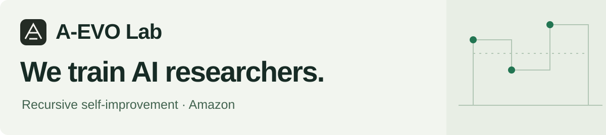

  

We study how AI systems can learn to do better research: proposing ideas, predicting their outcomes, and learning from real experiments. We also build agents that improve their own harness through experience.

**[Website](https://a-evo-lab.github.io/)** &nbsp; · &nbsp; **[Publications](https://a-evo-lab.github.io/publications.html)** &nbsp; · &nbsp; **[Open-source code](https://github.com/A-EVO-Lab/a-evolve)**

## Research

<table>
<tr>
<td width="50%" valign="top">

### Research World Models

**Which experiments are worth running?**

Use past experimental results to predict new outcomes, including in a different research environment.

[Explore RWM →](https://a-evo-lab.github.io/rwm/) · [Paper](https://arxiv.org/abs/2610.12235)

</td>
<td width="50%" valign="top">

### LM2LM

**Can models learn to propose better ideas?**

Train a language model to propose model improvements, using RWM feedback calibrated by real experiments.

[Explore LM2LM →](https://a-evo-lab.github.io/lm2lm/) · [Paper](https://arxiv.org/abs/2610.23344)

</td>
</tr>
</table>

**[A-Evolve](https://github.com/A-EVO-Lab/a-evolve)** — Our open-source framework for self-evolving agents. For autonomous model training, see [A-Evolve-Training](https://a-evo-lab.github.io/a-evolve-training/).

## Latest

- **Oct 2026** — [LM2LM](https://a-evo-lab.github.io/lm2lm/) and [Research World Models](https://a-evo-lab.github.io/rwm/): learning to propose and evaluate model improvements.

Earlier updates

- **Aug 2026** — [Evo-Harness](https://arxiv.org/abs/2608.15071), EMNLP 2026.
- **Jun 2026** — [A-Evolve-Training](https://a-evo-lab.github.io/a-evolve-training/): autonomous 30B post-training, 0.86 vs. 0.87 for the top human team.
- **Jun 2026** — [Adaptive Auto-Harness](https://arxiv.org/abs/2606.01770).
- **May 2026** — [Harness Updating Is Not Harness Benefit](https://arxiv.org/abs/2605.30621), EMNLP 2026.
- **Mar 2026** — [A-Evolve](https://github.com/A-EVO-Lab/a-evolve) open-sourced.

